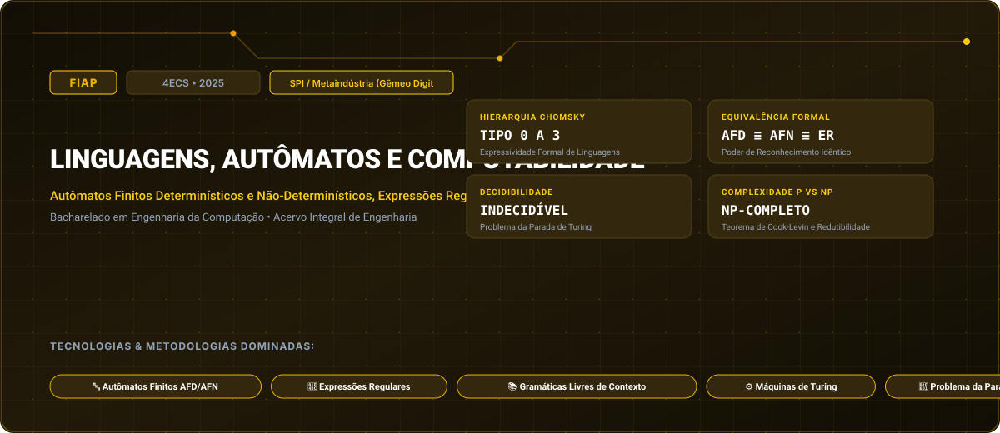

# FIAP • Linguagens, Autômatos e Computabilidade (2025)

> **Engenharia da Computação — FIAP (Faculdade de Informática e Administração Paulista)**  
> **Turma:** 4ECS • Ano Letivo 2025  
> **Desafio Corporativo Integrado:** SPI / Metaindústria (Gêmeo Digital & Células Robóticas)  
> **Portal Interativo GitHub Pages:** [https://guimemee.github.io/fiap-linguagens-automatos-e-computabilidade/](https://guimemee.github.io/fiap-linguagens-automatos-e-computabilidade/)

---

## 📋 Sumário Executivo do Acervo

Este repositório consolida o acervo acadêmico integral e os projetos práticos de engenharia da disciplina **Linguagens, Autômatos e Computabilidade**, contemplando:
1. **6 Checkpoints Oficiais (2025):** Enunciados integrais originais, memórias de cálculo passo a passo no padrão Symbolab e cadernos Jupyter (`.ipynb`) com gráficos executáveis.
2. **01_Apostilas_e_Teoria:** Livros didáticos, apostilas e slides de aulas.
3. **02_Exercicios_e_Laboratorios:** Listas práticas, scripts e códigos de laboratório.
4. **04_Global_Solution:** Desafios integradores semestrais da FIAP.
5. **05_Challenge_Sprints:** Sprints interdisciplinares de inovação corporativa (SPI / Metaindústria (Gêmeo Digital & Células Robóticas)).

---

## 🎯 6 Checkpoints Oficiais (2025)

- **Checkpoint 1:** Alfabetos, Cadeias, Linguagens Formais e Operações Algébricas &rarr; [`03_Provas_Avaliativas_Checkpoints/Checkpoint_1_cp1/Resolucao_Calculos.ipynb`](03_Provas_Avaliativas_Checkpoints/Checkpoint_1_cp1/Resolucao_Calculos.ipynb)
- **Checkpoint 2:** Autômatos Finitos Determinísticos (AFD) e Minimização de Hopcroft &rarr; [`03_Provas_Avaliativas_Checkpoints/Checkpoint_2_cp2/Resolucao_Calculos.ipynb`](03_Provas_Avaliativas_Checkpoints/Checkpoint_2_cp2/Resolucao_Calculos.ipynb)
- **Checkpoint 3:** Expressões Regulares e o Lema do Bombeamento para Linguagens Regulares &rarr; [`03_Provas_Avaliativas_Checkpoints/Checkpoint_3_cp3/Resolucao_Calculos.ipynb`](03_Provas_Avaliativas_Checkpoints/Checkpoint_3_cp3/Resolucao_Calculos.ipynb)
- **Checkpoint 4:** Gramáticas Livres de Contexto (GLC) e Autômatos com Pilha (AP) &rarr; [`03_Provas_Avaliativas_Checkpoints/Checkpoint_4_cp4/Resolucao_Calculos.ipynb`](03_Provas_Avaliativas_Checkpoints/Checkpoint_4_cp4/Resolucao_Calculos.ipynb)
- **Checkpoint 5:** Máquinas de Turing, Tese de Church-Turing e Linguagens Recursivas &rarr; [`03_Provas_Avaliativas_Checkpoints/Checkpoint_5_cp5/Resolucao_Calculos.ipynb`](03_Provas_Avaliativas_Checkpoints/Checkpoint_5_cp5/Resolucao_Calculos.ipynb)
- **Checkpoint 6:** Decidibilidade, o Problema da Parada de Turing e Classes de Complexidade P vs NP &rarr; [`03_Provas_Avaliativas_Checkpoints/Checkpoint_6_cp6/Resolucao_Calculos.ipynb`](03_Provas_Avaliativas_Checkpoints/Checkpoint_6_cp6/Resolucao_Calculos.ipynb)

---

## 🏛️ Créditos e Rastreabilidade
- **Instituição:** FIAP (Faculdade de Informática e Administração Paulista)
- **Curso:** Bacharelado em Engenharia da Computação
- **Turma:** 4ECS • Ano Letivo 2025
- **Aluno:** Guilherme Macário da Silva ([@Guimemee](https://github.com/Guimemee))
